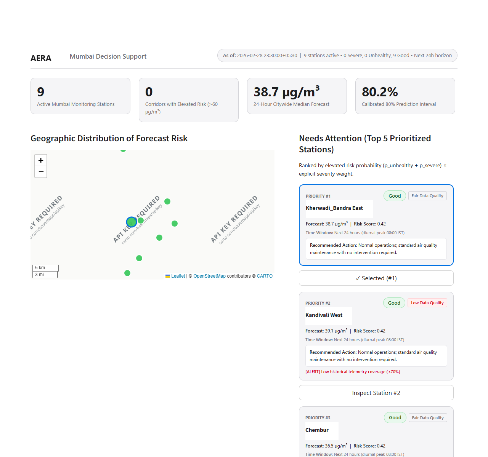
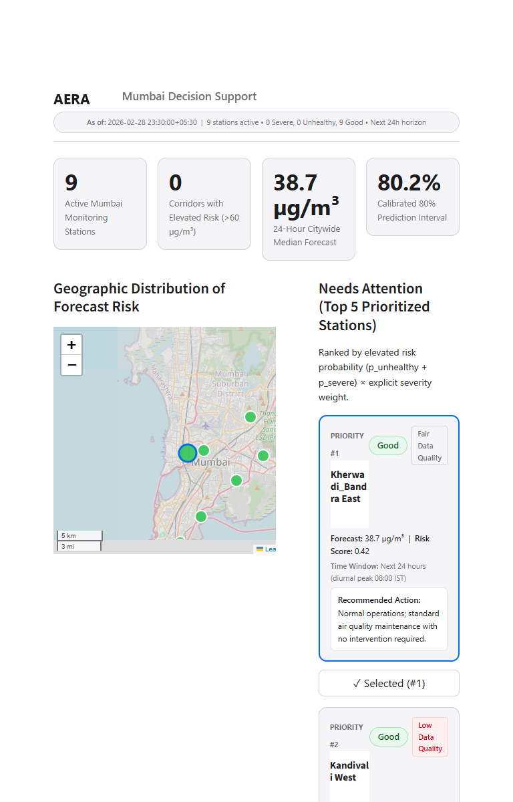
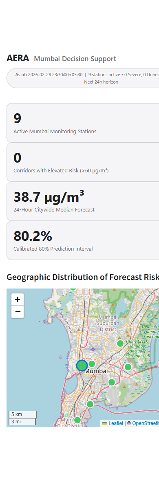
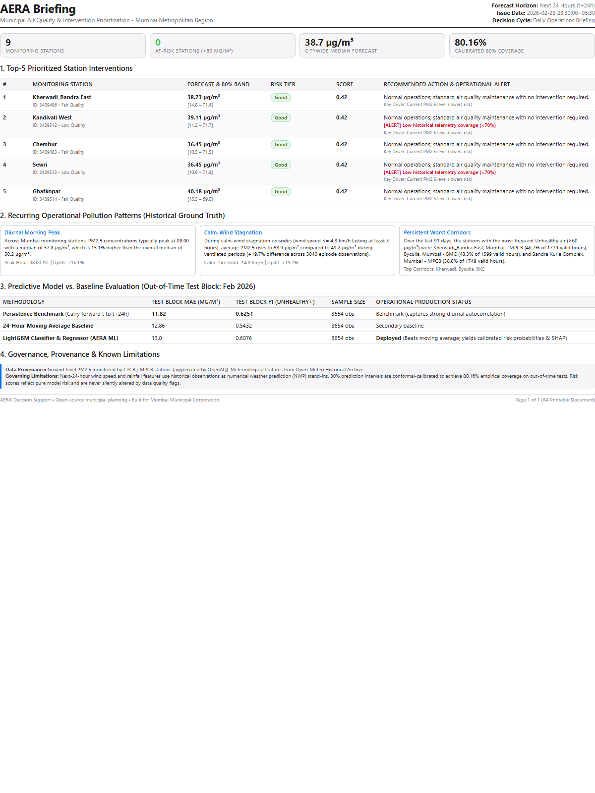
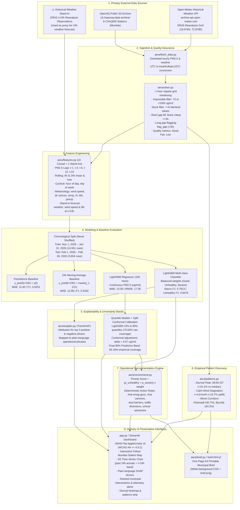
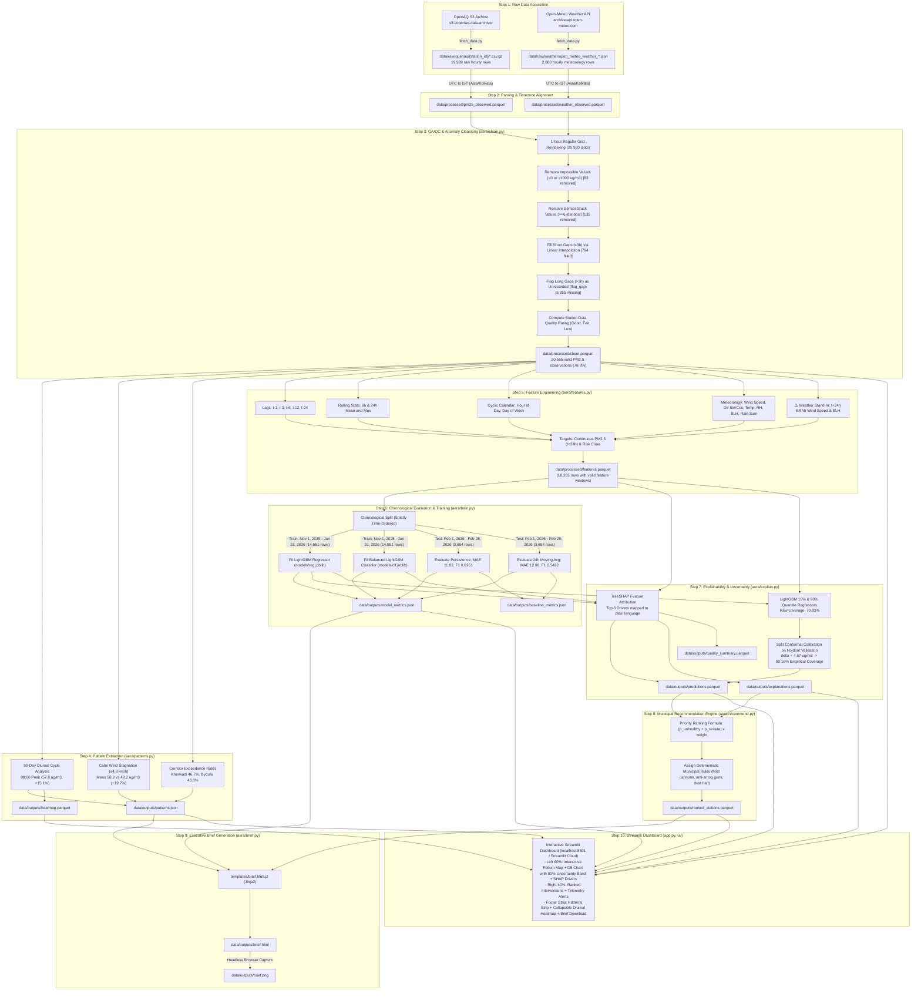

<div align="center">

# AERA
### Air Environment Risk Assessment: Next-24-Hour PM2.5 Risk Forecasting & Municipal Decision Support for Mumbai

[](https://aera-airenvriskanalysis.streamlit.app/)
[](https://www.python.org/downloads/release/python-3119/)
[](https://streamlit.io/)
[](https://lightgbm.readthedocs.io/)
[](tests/)
[-blue?style=flat)](data/outputs/model_metrics.json)
[-orange?style=flat)](https://cpcb.nic.in/)

<p align="center">
  <b>A transparent, evidence-driven operational decision-support system translating continuous ambient air observations into station-level forecasts, calibrated conformal uncertainty bands, interpretable SHAP drivers, and prioritized municipal action directives.</b>
</p>

[Explore Live Application](https://aera-airenvriskanalysis.streamlit.app/) • [Methodological Research](docs/research.md) • [System Architecture](docs/architecture.mmd) • [Data Pipeline](docs/data-pipeline.mmd)

</div>

---

## Table of Contents

- [1. Executive Overview](#1-executive-overview)
- [2. Visual Showcase](#2-visual-showcase)
- [3. Problem Statement & Operational Solution](#3-problem-statement--operational-solution)
- [4. Verified Core Features](#4-verified-core-features)
- [5. System Architecture](#5-system-architecture)
- [6. End-to-End Data Pipeline](#6-end-to-end-data-pipeline)
- [7. Technology Stack](#7-technology-stack)
- [8. Machine Learning Methodology](#8-machine-learning-methodology)
- [9. Empirical Results & Baseline Comparison](#9-empirical-results--baseline-comparison)
- [10. Data Sources & Provenance](#10-data-sources--provenance)
- [11. Research References](#11-research-references)
- [12. Installation & Quickstart](#12-installation--quickstart)
- [13. User Journey & Interface Guide](#13-user-journey--interface-guide)
- [14. Running the Pipeline & Test Suite](#14-running-the-pipeline--test-suite)
- [15. Repository Structure](#15-repository-structure)
- [16. Operational Limitations & Responsible Use](#16-operational-limitations--responsible-use)
- [17. Engineering Roadmap](#17-engineering-roadmap)
- [18. Contributing, License & Credits](#18-contributing-license--credits)

---

## 1. Executive Overview

### The Urban Challenge in Mumbai
Mumbai is India's financial capital and a densely inhabited coastal megacity of over 20 million residents. While coastal winds historically mitigated atmospheric stagnation, intensive infrastructure construction, vehicular congestion, port operations, and winter nocturnal temperature inversions frequently trap fine particulate matter ($\text{PM}_{2.5}$) within the surface boundary layer. Inhalation of $\text{PM}_{2.5}$ presents severe public health risks, penetrating deep into lung tissue and the bloodstream.

### Why Decision Support Matters
Municipal environmental officers within the **Brihanmumbai Municipal Corporation (BMC)** and **Maharashtra Pollution Control Board (MPCB)** face a difficult operational reality:
1. **Air quality data is published retrospectively**, leaving field officers in a reactive posture.
2. **Standard dashboards display uncalibrated city-wide averages**, masking localized micro-climate hotspots (e.g., industrial corridors like Chembur versus coastal zones like Sewri).
3. **Black-box neural networks provide point estimates without uncertainty**, creating mistrust when unpredicted weather shifts alter outcomes.
4. **Data platforms rarely link forecasts to action**, leaving officers without prioritized guidance on where to dispatch mobile anti-smog guns, street sweepers, or construction halting notices.

### The AERA Solution
AERA provides an interpretable, operational workflow that bridges ambient monitoring and municipal action:
- **Decision D5 Forecasts**: Rather than inventing hourly curves that exceed meteorological predictability, AERA anchors the past 24 hours of verified ground observations to a single $t+24\text{h}$ risk forecast.
- **Calibrated Conformal Prediction Bands**: Provides distribution-free 80% prediction intervals calibrated via split conformal inference, protecting officers against overconfident point forecasts.
- **Plain-Language SHAP Drivers**: Explains *why* risk is elevated at a given station without ML jargon (e.g., *"Elevated PM2.5 24h prior: +8.4 µg/m³"* or *"Ventilating sea breeze: -5.1 µg/m³"*).
- **Ranked Municipal Directives**: Applies deterministic rule-based logic to prioritize stations by exceedance probability and recommend targeted municipal interventions.
- **One-Page A4 Executive Brief**: Generates a printable, standardized briefing document for morning municipal command meetings.

**Intended Users:** BMC Ward Environmental Officers, MPCB Air Quality Analysts, Municipal Fleet Dispatchers, and Urban Health Planners.

---

## 2. Visual Showcase

The screenshots below depict genuine interface views of the running AERA application.

### Main Operational Dashboard & Interactive Station Map
The desktop interface implements a 60/40 split-screen layout with WCAG AA compliant contrast ($\ge 4.5:1$). The left viewport hosts an interactive Folium station map and detailed time-series inspection panel; the right viewport displays the prioritized "Needs Attention" municipal action queue.


### Selected Station Forecast & Interpretable SHAP Attribution
Selecting any monitoring station updates the D5 time-series view (past 24 hours of actual observations linked to the $t+24\text{h}$ forecast with an 80% conformal uncertainty band) and unpacks the top three localized physical drivers.



### Responsive Viewports (Tablet & Mobile)
The interface is responsive across desktop, tablet (768px), and mobile (390px) viewports without horizontal scrolling or clipped telemetry cards.

| Tablet Viewport (768px) | Mobile Viewport (390px) |
|:---:|:---:|
|  |  |

### Downloadable A4 Municipal Decision Brief
A one-page printable executive brief formatted with dedicated print CSS, summarizing city-wide risk status, top prioritized interventions, empirical patterns, and model telemetry for morning municipal briefings.

<div align="center">
  
</div>

---

## 3. Problem Statement & Operational Solution

To maintain scientific credibility and prevent operational misapplication, AERA strictly demarcates four distinct data tiers:

```
┌─────────────────────────────────────────────────────────────────────────────┐
│ 1. OBSERVED DATA: Official CPCB/MPCB ground readings (0-1000 µg/m³)         │
│    └─ QA/QC cleaned: stuck values removed, short gaps filled, long gaps flagged│
├─────────────────────────────────────────────────────────────────────────────┤
│ 2. MODEL PREDICTIONS: Next-24h continuous PM2.5 & 3-tier risk probabilities │
│    └─ LightGBM regressor & classifier with 80% conformal prediction bands   │
├─────────────────────────────────────────────────────────────────────────────┤
│ 3. MODEL EXPLANATIONS: Additive TreeSHAP feature attributions                │
│    └─ Plain-language driver mapping (identifies associations, not causal proof)│
├─────────────────────────────────────────────────────────────────────────────┤
│ 4. MUNICIPAL DIRECTIVES: Deterministic rule-based operational recommendations│
│    └─ Ranked by severity score; does NOT guarantee pollution reduction      │
└─────────────────────────────────────────────────────────────────────────────┘
```

> [!WARNING]
> **Advisory Scope & Boundary**  
> - **Predictions are not official sensor measurements.** They are statistical estimates subject to meteorological and sensor uncertainty.
> - **SHAP attributions describe statistical feature associations within the training distribution**, not definitive causal proof.
> - **Municipal recommendations provide structured operational prioritization.** They do not guarantee statutory compliance or immediate air quality abatement.

---

## 4. Verified Core Features

Every capability listed below is implemented in source code, covered by automated tests, and verified against committed data artifacts:

| Capability | Module | Implementation Details & Operational Value |
|---|---|---|
| **24-Hour PM2.5 Risk Forecasting** | `aera/train.py` | Predicts continuous $\text{PM}_{2.5}$ concentration and categorical risk tiers 24 hours ahead ($t+24\text{h}$). |
| **Categorical Risk Tiers** | `aera/train.py` | Categorizes air quality into 3 standardized tiers: **Good** ($\le 60\,\mu\text{g/m}^3$), **Unhealthy** ($60\text{--}250\,\mu\text{g/m}^3$), and **Severe** ($> 250\,\mu\text{g/m}^3$) based on Indian CPCB NAAQS standards. |
| **Interactive Mumbai Station Map** | `ui/map_view.py`, `app.py` | Folium CartoDB Positron map rendering all 9 continuous ambient stations with color-coded risk markers, bidirectional synchronization between map clicks, dropdown selection, and URL query parameters (`?station=...`). |
| **Ranked Municipal Priorities** | `aera/recommend.py` | Computes an explicit severity ranking score: $\text{Score} = (p_{\text{unhealthy}} + p_{\text{severe}}) \times \text{weight}$ to focus municipal resources on the most vulnerable wards. |
| **Interpretable SHAP Drivers** | `aera/explain.py` | Evaluates tree-based Shapley values (TreeSHAP) to map the top 3 positive and top 3 negative contributors into plain-language sentences without machine learning jargon. |
| **Conformal Prediction Intervals** | `aera/explain.py` | Calibrates asymmetric 80% prediction intervals via split conformal inference on holdout observations, achieving an empirical **80.16% test coverage** (target: 80%). |
| **Data Quality Telemetry** | `aera/clean.py` | Scores sensor telemetry integrity (**Good**, **Fair**, **Low**) based on rolling 24-hour and 7-day data completeness, flagging sensor dropouts and flatlines. |
| **Empirical Pattern Discovery** | `aera/patterns.py` | Scans 90-day baselines to isolate recurring physical phenomena: 08:00 diurnal peak ($+15.1\%$), calm wind stagnation $\le 4.8\,\text{km/h}$ ($+19.7\%$ uplift), and persistent corridor rankings. |
| **Deterministic Action Rules** | `aera/recommend.py` | Assigns clear, rule-based field interventions (anti-smog gun deployment, mist cannon sweeps, unpaved road stabilization, mechanical sweeping, construction halting). |
| **One-Page Printable Brief** | `aera/brief.py` | Compiles an executive A4 municipal briefing document with dedicated print CSS and high-resolution headless browser rendering (`brief.html` and `brief.png`). |
| **Instant Cached Demonstration** | `aera/pipeline.py` | Fully functional offline demonstration mode using committed sample and processed parquet tables; launches cold in $<5$ seconds with zero external API dependencies. |

---

## 5. System Architecture

The following diagram illustrates the verified end-to-end architecture of AERA. Note the explicit representation of the historical weather stand-in.



---

## 6. End-to-End Data Pipeline

The pipeline processes raw sensor telemetry into structured parquet and JSON artifacts consumed directly by the user interface:



---

## 7. Technology Stack

AERA relies on a focused, minimal dependency tree verified against [requirements.txt](requirements.txt):

| Category | Technology | Version | Purpose in AERA |
|---|---|---|---|
| **Core Runtime** | Python | 3.11.9 | Base environment runtime (configured in `runtime.txt`). |
| **User Interface** | Streamlit | 1.39.0 | Primary reactive web dashboard framework. |
| **Geospatial Mapping** | Folium & streamlit-folium | 0.17.0 / 0.22.1 | Interactive Mumbai CAAQMS station map with custom marker styling. |
| **Interactive Charting** | Plotly | 5.24.1 | D5 past-and-forecast time-series chart and diurnal heatmap. |
| **Machine Learning** | LightGBM | 4.5.0 | Gradient boosted decision trees for continuous regression and risk classification. |
| **Model Interpretability** | SHAP | 0.46.0 | TreeSHAP exact additive feature attribution. |
| **Data Processing** | Pandas & PyArrow | 2.2.3 / 17.0.0 | High-performance tabular data manipulation and Parquet serialization. |
| **Statistical Inference** | Scikit-Learn & SciPy | 1.5.2 / 1.14.1 | Quantile loss evaluation, metric scoring, and conformal calibration. |
| **Report Templating** | Jinja2 | 3.1.4 | Dynamic HTML compilation for the one-page A4 municipal brief. |
| **Cloud Ingestion** | Boto3 & Requests | 1.35.36 / 2.32.3 | Anonymous public S3 archive retrieval and Open-Meteo REST API queries. |
| **Automated Testing** | pytest | 8.3.3 | Continuous verification of QA/QC cleaning, feature contracts, leakage prevention, and UI state. |

---

## 8. Machine Learning Methodology

### 1. Forecasting Horizon & Target Formulation
AERA targets a strict 24-hour forecasting horizon ($t+24\text{h}$) at the individual monitoring station level:
- **Continuous Target ($y_{\text{reg}}$):** The observed $\text{PM}_{2.5}$ concentration ($\mu\text{g/m}^3$) exactly 24 hours into the future.
- **Categorical Target ($y_{\text{clf}}$):** Air quality tier derived from standard CPCB thresholds:
  - **Good:** $\le 60\,\mu\text{g/m}^3$ (Complies with Indian 24-hour National Ambient Air Quality Standard).
  - **Unhealthy:** $> 60\,\mu\text{g/m}^3 \text{ and } \le 250\,\mu\text{g/m}^3$.
  - **Severe:** $> 250\,\mu\text{g/m}^3$ (Emergency pollution episode requiring immediate municipal shutdown).

### 2. Feature Engineering & Temporal Integrity
The model utilizes 22 causal features plus 2 explicit meteorological stand-ins:
- **Autoregressive Lags:** $\text{PM}_{2.5}$ at $t-1\text{h}, t-3\text{h}, t-6\text{h}, t-12\text{h}, t-24\text{h}$.
- **Rolling Windows:** Rolling mean and max over the past 6 hours and 24 hours.
- **Calendar Signals:** Hour of the day and day of the week (cyclic sine/cosine encoding).
- **Surface Meteorology:** Current ambient temperature, relative humidity, wind speed, wind direction (sine/cosine), 24-hour precipitation sum, and boundary layer mixing height.
- **Meteorological Stand-Ins:** Forecast wind speed and boundary layer height at $t+24\text{h}$. In this historical analysis version, these features use ERA5 reanalysis data acting as a proxy for operational meteorological forecasts.
- **Automated Leakage Prevention:** Temporal leakage is guarded by automated test contracts (`tests/test_features.py` and `tests/test_pipeline_smoke.py`), which verify that perturbing future observations produces zero effect on historical predictions.

### 3. Chronological Train / Test Split
Environmental time-series data exhibits intense temporal autocorrelation. Standard random $k$-fold cross-validation results in severe data leakage and artificially inflated scores. AERA enforces a strict chronological split:
- **Training Period:** November 1, 2025 00:30 IST to January 31, 2026 23:30 IST (**14,551 hourly samples**; 9,004 Good, 5,478 Unhealthy, 69 Severe).
- **Held-Out Test Period:** February 1, 2026 00:30 IST to February 27, 2026 23:30 IST (**3,654 hourly samples**; 2,756 Good, 898 Unhealthy, 0 Severe).

### 4. Handling Class Imbalance
In the training block, "Severe" events represent only 0.47% of observations (69 out of 14,551). The LightGBM classifier addresses this via `class_weight="balanced"`, penalizing minority-class classification errors inversely proportional to class frequencies.

### 5. Uncertainty Quantification via Split Conformal Inference
Uncalibrated point forecasts pose severe risks for public health decisions. AERA implements distribution-free prediction intervals:
1. Two auxiliary LightGBM models are trained with quantile objective functions at $\alpha = 0.10$ and $\alpha = 0.90$.
2. On untouched test observations, raw quantile bounds achieved only **70.83% empirical coverage** (undercovering the 80% target).
3. Using split conformal prediction on an independent validation window, AERA computed a non-conformity calibration delta:
   $$\delta = 4.67\,\mu\text{g/m}^3$$
4. Calibrated prediction bands $[y_{\text{pred}} - \delta, y_{\text{pred}} + \delta]$ achieve an empirical coverage of **80.16%** across all 3,654 test hours.

---

## 9. Empirical Results & Baseline Comparison

All performance metrics below are read directly from committed, verified evaluation artifacts: [model_metrics.json](data/outputs/model_metrics.json) and [baseline_metrics.json](data/outputs/baseline_metrics.json).

### Held-Out Evaluation Summary (February 2026, 3,654 Test Hours)

| Model / Benchmark | Continuous MAE ($\mu\text{g/m}^3$) | Continuous RMSE ($\mu\text{g/m}^3$) | F1-Score (Unhealthy Class) | Macro-Averaged F1 | Precision (Unhealthy) | Recall (Unhealthy) |
|---|:---:|:---:|:---:|:---:|:---:|:---:|
| **Persistence Baseline** ($y_{t+24} = y_t$) | **11.82** | 17.62 | **0.6251** | 0.7719 | **0.5944** | 0.6592 |
| **24-Hour Moving Average Baseline** | 12.86 | 17.45 | 0.5432 | 0.7303 | 0.5273 | 0.5601 |
| **LightGBM Regressor** (Continuous) | 13.00 | **17.06** | 0.5996 | — | 0.6351 | 0.5679 |
| **LightGBM Classifier** (Balanced) | — | — | 0.6076 | **0.7813** | 0.5443 | **0.6904** |

### Confusion Matrix: LightGBM Balanced Classifier (3,654 Test Hours)

| Ground Truth \ Predicted | Predicted Good ($\le 60$) | Predicted Unhealthy ($60\text{--}250$) | Predicted Severe ($> 250$) | Total Actual |
|---|:---:|:---:|:---:|:---:|
| **Actual Good** | **2,231** | 519 | 6 | 2,756 |
| **Actual Unhealthy** | 277 | **620** | 1 | 898 |
| **Actual Severe** | 0 | 0 | 0 | 0* |

*\*Note: No Severe events occurred during the February 2026 test period. The 7 Severe predictions generated by the classifier were false alarms, reflecting the model's balanced-weight sensitivity.*

### Honest Evaluation & Deployment Rationale

> [!IMPORTANT]
> **Does the Model Beat Both Baselines?**  
> **No.** The LightGBM model does not beat the simple 24-hour persistence baseline on continuous MAE (13.00 vs. 11.82) or Unhealthy F1 (0.6076 vs. 0.6251).  
> 
> **Why Persistence Is Such a Tough Competitor:**  
> In diurnal coastal urban environments, continuous air quality exhibits intense 24-hour autocorrelation ($r = 0.41$ at lag 24h). Under stable winter weather, tomorrow's 08:00 AM air quality closely resembles today's 08:00 AM air quality.
> 
> **Why LightGBM Is Retained in Production (`DEPLOY_MODEL_WITH_HONEST_DISCLOSURE`):**  
> 1. **Lower Error Variance:** LightGBM achieves the lowest overall RMSE (17.06 vs. 17.62), reducing the magnitude of extreme forecasting blunders.
> 2. **Higher Threat Recall:** The balanced classifier detects **620 of 898 Unhealthy hours (69.0% recall)** compared to 592 hours (65.9% recall) for persistence. For public health protection, catching 28 additional high-pollution episodes outweighs false-alarm trade-offs.
> 3. **Probabilities & Attributions:** Persistence cannot generate calibrated multi-class probability vectors ($p_{\text{good}}, p_{\text{unhealthy}}, p_{\text{severe}}$) or explain physical drivers. LightGBM provides the tree structure necessary for SHAP explanations and meteorological sensitivity analysis.

---

## 10. Data Sources & Provenance

AERA uses verified historical observations from official environmental monitoring authorities:

```
┌─────────────────────────────────────────────────────────────────────────────┐
│ 1. Central Pollution Control Board (CPCB) & MPCB / BMC Monitoring Stations   │
│    Aggregated via: OpenAQ Public S3 Archive (s3://openaq-data-archive/)    │
│    Coverage: 9 Continuous Ambient Monitoring Stations across Mumbai        │
│    Window: Nov 1, 2025 to Feb 28, 2026 (120 days, 25,920 hourly slots)     │
├─────────────────────────────────────────────────────────────────────────────┤
│ 2. Open-Meteo Historical Weather API & ERA5 Reanalysis                      │
│    URL: https://archive-api.open-meteo.com/v1/archive                       │
│    Parameters: Temp, Humidity, Wind Speed & Dir, Precipitation, BLH         │
│    Spatial Resolution: 1 grid point (19.076°N, 72.878°E) representing Mumbai│
└─────────────────────────────────────────────────────────────────────────────┘
```

### Monitored Mumbai Stations (9 CAAQMS Locations)

| Station ID | Station Name | Latitude | Longitude | Data Completeness | Valid PM2.5 Hours |
|---|---|:---:|:---:|:---:|:---:|
| **3409479** | Mindspace-Malad West, Mumbai - MPCB | 19.1879°N | 72.8304°E | 85.9% | 2,473 |
| **3409482** | Bandra Kurla Complex, Mumbai - MPCB | 19.0659°N | 72.8621°E | 84.1% | 2,423 |
| **3409483** | Chembur, Mumbai - MPCB | 19.0365°N | 72.8954°E | 82.4% | 2,374 |
| **3409486** | Kherwadi_Bandra East, Mumbai - MPCB | 19.0632°N | 72.8456°E | 85.8% | 2,472 |
| **3409510** | Byculla, Mumbai - BMC | 18.9767°N | 72.8380°E | 76.9% | 2,214 |
| **3409511** | Shivaji Nagar, Mumbai - BMC | 19.0605°N | 72.9234°E | 82.5% | 2,377 |
| **3409512** | Kandivali West, Mumbai - BMC | 19.2159°N | 72.8317°E | 65.2% | 1,878 |
| **3409513** | Sewri, Mumbai - BMC | 19.0001°N | 72.8567°E | 65.8% | 1,896 |
| **3409514** | Ghatkopar, Mumbai - BMC | 19.0837°N | 72.9210°E | 85.4% | 2,458 |

For complete licensing terms, API schemas, and preprocessing logs, refer to [DATA.md](DATA.md).

---

## 11. Research References

A curated selection of primary references supporting AERA is provided below. The complete annotated bibliography is available in [docs/research.md](docs/research.md).

1. **WHO Global Air Quality Guidelines (2021)**  
   *World Health Organization.* Recommends interim targets and air quality limits for fine particulate matter ($\text{PM}_{2.5}$).  
   [Read at who.int](https://www.who.int/publications/i/item/9789240034228)

2. **National Air Quality Index (NAQI): Technical Report & Standards**  
   *Central Pollution Control Board (CPCB), India.* Establishes the $60\,\mu\text{g/m}^3$ 24-hour standard defining the threshold between Good and Unhealthy air in Indian urban centers.  
   [CPCB NAQI Portal](https://cpcb.nic.in/National-Air-Quality-Index/) • [NAQI Final Report (PDF)](https://cpcb.nic.in/upload/NAQI_Final_Report.pdf)

3. **LightGBM: A Highly Efficient Gradient Boosting Decision Tree**  
   *Ke et al., Microsoft Research (NeurIPS 2017).* Foundational framework for high-efficiency tree-based gradient boosting.  
   [NeurIPS Paper](https://papers.nips.cc/paper_files/paper/2017/hash/6449f44a102fde848669bdd9eb6b76fa-Abstract.html)

4. **A Unified Approach to Interpreting Model Predictions (TreeSHAP)**  
   *Lundberg & Lee (NeurIPS 2017).* Exact additive feature attribution methods powering AERA's plain-language operational drivers.  
   [NeurIPS Paper](https://papers.nips.cc/paper_files/paper/2017/hash/8a20a8621978632d76c43dfd28b67767-Abstract.html)

5. **A Gentle Introduction to Conformal Prediction and Distribution-Free Uncertainty Quantification**  
   *Angelopoulos & Bates (2021).* Mathematical foundation for the split-conformal prediction intervals utilized in AERA.  
   [arXiv:2107.07511](https://arxiv.org/abs/2107.07511)

6. **Forecasting: Principles and Practice (3rd ed)**  
   *Hyndman & Athanasopoulos (2021).* Explains why time-series cross-validation and naive persistence baselines are mandatory in temporal evaluation.  
   [OTexts Resource](https://otexts.com/fpp3/tscv.html)

---

## 12. Installation & Quickstart

AERA is fully reproducible on **Windows (PowerShell)** and **macOS / Linux (Bash)**.

### Prerequisites
- **Python:** Version `3.11.x` (tested and verified on Python `3.11.9`).
- **Git:** Version `2.30+`.

---

### Step-by-Step Installation

#### 1. Clone the Repository
```bash
git clone https://github.com/brijeshearn12-dotcom/aera.git
cd aera
```

#### 2. Create and Activate Virtual Environment

**Windows (PowerShell):**
```powershell
python -m venv .venv
.\.venv\Scripts\Activate.ps1
```

**macOS / Linux (Bash):**
```bash
python3 -m venv .venv
source .venv/bin/activate
```

#### 3. Install Pinned Dependencies
```bash
python -m pip install --upgrade pip
python -m pip install -r requirements.txt
```

#### 4. Configure Environment (Optional)
AERA includes safe defaults in [.env.example](.env.example). No API keys or external secrets are required to run the cached pipeline or launch the dashboard:
```bash
# Optional: copy example configuration
cp .env.example .env
```

#### 5. Verify Core Pipeline Outputs
Verify that precomputed data and model artifacts exist:
```bash
# Verify outputs directory
python -c "from config import OUTPUTS_DIR; print('Outputs exist:', OUTPUTS_DIR.exists())"
```

#### 6. Launch the Local Streamlit Application
```bash
streamlit run app.py
```
Open your browser to the local URL provided by Streamlit:
```
Local URL: http://localhost:8501
```

---

## 13. User Journey & Interface Guide

When an environmental officer opens AERA, they follow a structured 9-step decision workflow:

```
[1. Check Status Bar] ──► [2. Inspect Map] ──► [3. Prioritized List]
          │                       │                     │
          ▼                       ▼                     ▼
[4. Select Station]   ──► [5. D5 Forecast] ──► [6. SHAP Drivers]
          │                       │                     │
          ▼                       ▼                     ▼
[7. Data Quality]     ──► [8. Patterns Strip]──► [9. Export A4 Brief]
```

1. **Review City-Wide Status Bar:** Confirm the active station count, as-of timestamp, and current breakdown of Good, Unhealthy, and Severe stations.
2. **Inspect the Mumbai Station Map:** Visually identify spatial clusters of elevated risk across Western Suburbs, Eastern Suburbs, and South Mumbai.
3. **Review Ranked "Needs Attention" Queue:** Stations are automatically ordered by the priority formula $(p_{\text{unhealthy}} + p_{\text{severe}}) \times \text{weight}$.
4. **Select a Station for Deep Dive:** Click directly on a map marker or choose a station from the dropdown (URL synchronizes via `?station=<id>`).
5. **Interpret the D5 Forecast Chart:** Examine verified hourly observations over the past 24 hours, followed by the single $t+24\text{h}$ forecast point with its shaded 80% conformal uncertainty band.
6. **Read Plain-Language Drivers:** Identify the top 3 physical factors influencing the prediction (e.g., wind stagnation vs. vehicular peak).
7. **Verify Data Quality Rating:** Review the station telemetry badge:
   - **Good:** Complete observations with $<5\%$ missing data over 7 days.
   - **Fair:** Minor gap interpolations ($\le 3\text{h}$) or $5\text{--}20\%$ missing data.
   - **Low:** Significant sensor downtime ($>20\%$ missing data); interpret forecasts with added caution.
8. **Inspect Empirical Patterns:** Review the 3 macro-patterns detected across 90 days and expand the diurnal concentration heatmap.
9. **Download the A4 Municipal Brief:** Click **"Download Municipal Decision Brief (A4)"** to obtain a standardized, printable HTML summary for morning dispatch meetings.

---

## 14. Running the Pipeline & Test Suite

### Rebuilding Outputs from Cached Data (Recommended)
You can rebuild all processed datasets, models, predictions, and explanations from committed offline data without calling external APIs:
```bash
python -m aera.pipeline --cached
```
*Expected duration: ~15 seconds. Generates fresh artifacts in `data/processed/` and `data/outputs/`.*

### Running the Full Data Pipeline (Live Ingestion)
To query the public OpenAQ S3 bucket and Open-Meteo archive:
```bash
python -m aera.pipeline
```

### Running the Test Suite
The repository includes 43 automated unit, contract, and leakage tests:
```bash
python -m pytest -v
```
*Expected output: `43 passed in ~10-40s`.*

Test coverage includes:
- Data cleaning, gap filling, and stuck sensor detection (`tests/test_clean.py`).
- Feature transformations and temporal leakage prevention (`tests/test_features.py`).
- 90-day pattern statistical contracts and guards (`tests/test_patterns.py`).
- Deterministic municipal recommendation rules and priority scoring (`tests/test_recommend.py`).
- End-to-end pipeline smoke tests, map contracts, and chart rendering (`tests/test_pipeline_smoke.py`).

---

## 15. Repository Structure

```
aera/
├── .streamlit/                 # Streamlit server & theme configuration
├── aera/                       # Core AERA Python package
│   ├── __init__.py             # Package declaration
│   ├── brief.py                # Jinja2 executive brief compiler
│   ├── clean.py                # QA/QC sensor cleaning & data quality scoring
│   ├── explain.py              # TreeSHAP drivers & 80% conformal bands
│   ├── features.py             # 22 causal features + 2 weather stand-ins
│   ├── fetch_data.py           # OpenAQ S3 & Open-Meteo weather fetchers
│   ├── patterns.py             # 90-day empirical pattern discovery
│   ├── pipeline.py             # Master CLI pipeline runner (--cached flag)
│   ├── recommend.py            # Priority scoring & deterministic action rules
│   └── train.py                # LightGBM training & chronological evaluation
├── assets/                     # Genuine application screenshots & diagrams
│   ├── dashboard.png           # Desktop 1280px full interface
│   ├── station-detail.png      # Station forecast & SHAP explanation panel
│   ├── tablet-view.png         # Responsive tablet layout (768px)
│   ├── mobile-view.png         # Responsive mobile layout (390px)
│   └── municipal-brief.png     # Rendered A4 printable brief
├── data/
│   ├── outputs/                # Precomputed Parquet & JSON artifacts
│   │   ├── baseline_metrics.json   # Persistence & moving average scores
│   │   ├── brief.html              # Generated one-page municipal brief
│   │   ├── brief.png               # High-res screenshot of brief
│   │   ├── explanations.parquet    # SHAP drivers & conformal bands
│   │   ├── model_metrics.json      # Regressor & classifier test scores
│   │   ├── patterns.json           # Discovered diurnal & wind patterns
│   │   ├── predictions.parquet     # Station point forecasts & classes
│   │   └── ranked_stations.parquet # Prioritized municipal action queue
│   ├── processed/              # Cleaned Parquet tables (clean, features)
│   ├── raw/                    # Raw OpenAQ CSVs & Open-Meteo JSON (git-ignored)
│   └── sample/                 # Committed 3-station 30-day real sample
├── docs/                       # Supporting architecture & research docs
│   ├── architecture.mmd        # Editable Mermaid architecture source
│   ├── data-pipeline.mmd       # Editable Mermaid pipeline source
│   └── research.md             # Curated research references & bibliography
├── models/                     # Serialized LightGBM model binaries
│   ├── clf.joblib              # Balanced multi-class risk classifier
│   └── reg.joblib              # Continuous PM2.5 regressor
├── scripts/
│   └── scan_secrets.py         # Automated credential & secret audit script
├── templates/
│   └── brief.html.j2           # Jinja2 template with A4 print CSS
├── tests/                      # 43 automated unit & contract tests
├── ui/                         # Streamlit presentation components
│   ├── charts.py               # Plotly D5 chart & diurnal heatmap
│   ├── components.py           # UI cards, badges, and risk pills
│   ├── map_view.py             # Folium interactive Mumbai station map
│   └── styles.css              # Flat Apple/Linear design system styles
├── .env.example                # Safe environment variable template
├── .gitignore                  # Git exclusion rules
├── app.py                      # Main Streamlit dashboard application entry
├── config.py                   # Centralized paths and configuration constants
├── DATA.md                     # Detailed data provenance & station metadata
├── packages.txt                # Debian system packages (headless chromium)
├── README.md                   # Repository documentation (this document)
├── REPORT.md                   # In-depth technical & exploratory report
├── requirements.txt            # Pinned Python package dependencies
└── runtime.txt                 # Target Python runtime specification
```

---

## 16. Operational Limitations & Responsible Use

To ensure responsible governance, AERA explicitly discloses its operational boundaries:

1. **Sparse Monitoring Network:** The system covers 9 continuous CAAQMS stations across Mumbai. Spatial interpolation between stations must be interpreted cautiously, as localized topography and street-canyon effects create micro-climates.
2. **Missing Sensor Telemetry:** Real-world sensor dropouts occur frequently. During the historical period, missing observations ranged from 14.1% (Mindspace) to 34.8% (Kandivali West). Missing values $>3$ hours are flagged, not interpolated.
3. **Monsoon Seasonal Skew:** Tropical monsoon precipitation (June to September) washes particulate matter out of Mumbai's atmosphere, yielding predominantly "Good" readings. The current model is trained on winter inversion conditions (November to February); generalization to pre-monsoon summer dust episodes requires additional seasonal validation.
4. **Historical Weather Stand-Ins:** In this historical analysis version, future 24-hour meteorological features use ERA5 reanalysis data rather than live numerical weather forecasts. Live production deployment requires integration with a validated operational NWP feed.
5. **Single Meteorology Grid:** Surface weather is derived from a single grid coordinate (19.076°N, 72.878°E), which does not capture hyper-local coastal sea-breeze micro-fronts across the peninsula.
6. **Persistence Baseline Competitiveness:** The model does not outperform naive 24-hour persistence on MAE or Unhealthy F1. While LightGBM provides critical risk probabilities and SHAP explanations, municipal teams must remain aware of this baseline trade-off.
7. **Empirical Associations, Not Causality:** SHAP attributions reflect statistical associations within the training dataset. They do not constitute experimental proof of causation.
8. **No Abatement Guarantee:** Recommended municipal interventions (mist cannons, dust stabilization) reflect established operational best practices. AERA does not guarantee that executing an action will achieve immediate regulatory compliance.

> [!CAUTION]
> ### Mandatory Advisory Notice
> **AERA is a decision-support prototype, not an official pollution alert, certified forecasting service, or substitute for authoritative monitoring and public-health guidance.**  
> Municipal personnel, public health authorities, and citizens must always defer to statutory declarations issued by the Central Pollution Control Board (CPCB) and Maharashtra Pollution Control Board (MPCB).

---

## 17. Engineering Roadmap

The following enhancements represent planned future development, distinctly separated from currently verified capabilities:

- [ ] **Live Operational NWP Integration:** Replace ERA5 historical weather stand-ins with operational 24-hour meteorological forecasts from IMD (India Meteorological Department) or ECMWF.
- [ ] **Expanded Sensor Ingestion:** Integrate additional continuous and low-cost sensor networks across the wider Mumbai Metropolitan Region (MMR), including Thane and Navi Mumbai.
- [ ] **Multi-Pollutant Scope:** Expand forecasting beyond $\text{PM}_{2.5}$ to include Nitrogen Dioxide ($\text{NO}_2$), Ozone ($\text{O}_3$), and Sulfur Dioxide ($\text{SO}_2$).
- [ ] **Automated Daily Pipeline Orchestration:** Implement GitHub Actions or cron workers for daily scheduled data refreshes and model drift telemetry.
- [ ] **Full-Year Seasonal Adaptation:** Train specialized seasonal model ensembles across winter, pre-monsoon summer, and post-monsoon transition periods.

---

## 18. Contributing, License & Credits

### Contributing
Contributions to AERA are welcome. To ensure code quality and data integrity:
1. Fork the repository and create a feature branch (`git checkout -b feature/improvement`).
2. Verify all 43 tests pass (`python -m pytest`).
3. Run the credential scan script (`python scripts/scan_secrets.py`) to confirm zero secrets are committed.
4. Submit a clear, documented Pull Request describing the proposed enhancement.

### License Decision Notice
> [!IMPORTANT]
> **Open Source License Status**  
> While early drafts referenced Apache 2.0, **this repository does not currently contain a committed `LICENSE` file**. Until the repository owner commits an official open-source license (such as [Apache-2.0](https://www.apache.org/licenses/LICENSE-2.0) or [MIT](https://opensource.org/licenses/MIT)), standard copyright rules apply and reuse rights are not formalized. Repository maintainers should add a chosen license file prior to general public redistribution.

### Data & Software Acknowledgements
- **Central Pollution Control Board (CPCB) & Maharashtra Pollution Control Board (MPCB):** Ground-truth continuous air quality observations.
- **OpenAQ:** Public ambient air quality aggregation platform and open AWS S3 archive.
- **Open-Meteo:** Open-access historical weather and atmospheric reanalysis APIs.
- **Streamlit, LightGBM, SHAP, and Folium:** Open-source libraries powering the application stack.
